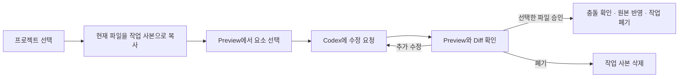
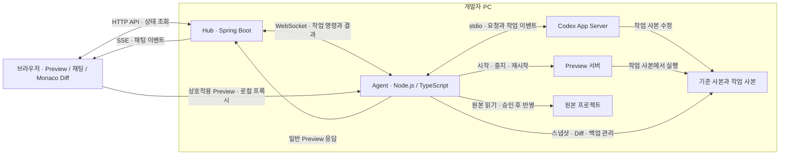

# WebStudio

WebStudio는 이미 만들어진 웹 프로젝트를 브라우저에서 보면서 수정하는 로컬 개발 도구입니다. 바꾸고 싶은 버튼이나 영역을 Preview에서 고른 다음, Codex에 원하는 동작을 설명할 수 있습니다. 수정된 화면을 다시 열어 보고, 코드 차이까지 확인한 뒤 필요한 파일만 원본에 반영합니다.

예를 들어 관리자 화면의 검색 폼을 바꾸고 싶다면, 코드를 찾기 전에 Preview에서 폼을 선택하고 “검색 조건은 유지하고 버튼을 오른쪽에 배치해 줘”라고 요청할 수 있습니다. Codex는 작업 사본에서 수정합니다. 결과가 마음에 들면 적용하고, 다시 시도하고 싶으면 작업 사본의 변경을 되돌리면 됩니다.

## 주요 기능

| 기능 | 할 수 있는 일 |
| --- | --- |
| 프로젝트 등록 | 로컬 폴더, 빌드·시작 명령, 포트, 첫 화면 경로를 등록합니다. 기존 설정은 등록 화면에서 다시 불러와 수정할 수 있습니다. |
| Preview | 현재 파일 상태로 만든 사본에서 사이트를 실행합니다. 작업은 유지한 채 서버만 끄거나 다시 켤 수 있습니다. 지원되는 로컬 프로젝트에서는 로그인, 폼 제출, AJAX 동작도 확인할 수 있습니다. |
| 화면 요소 선택 | 클릭하거나 드래그해서 선택한 요소의 구조를 채팅에 첨부합니다. Inspector가 수집하는 정보는 태그, 구조 기반 selector, 화면 위치 등입니다. |
| Codex 채팅 | 응답 조각은 도착하는 대로 채팅에 표시됩니다. 같은 작업에서 후속 요청을 이어가거나 진행 중인 요청을 중지할 수 있습니다. CLI가 제공하는 모델과 추론 강도를 선택할 수 있습니다. |
| 변경 검토 | Monaco에서 작업 전체의 Code Diff와 SQL 관련 변경을 확인합니다. 채팅에서는 요청별로 바뀐 내용을 볼 수 있고, 가장 최근에 변경을 만든 요청부터 작업 사본에서 되돌릴 수 있습니다. 요청이 끝나면 바뀐 파일의 전후 내용과 충돌 확인용 해시만 보관합니다. |
| 확정 적용 | 검토한 파일을 골라 원본에 적용합니다. 적용에 성공하면 작업 사본을 폐기하며, 현재 페이지에서 적용을 되돌릴 수 없습니다. |

## 작업 흐름



작업 시작 시점의 디스크 상태를 기준으로 사본을 만듭니다. Git에 아직 커밋하지 않은 변경도 포함됩니다. 원본에 쓰는 시점은 **선택 파일 적용하기 → 확정 적용하기**을 눌렀을 때입니다. 작업 시작 뒤 원본이 바뀌었거나 검토한 Diff가 최신 상태와 다르면 적용을 중단합니다.

확정 적용에 성공하면 작업 사본, 미반영 변경, 요청별 Diff, 백업을 함께 폐기합니다. 채팅의 **이 요청 되돌리기**는 확정 전 작업 사본에서 사용할 수 있습니다.

Hub 또는 Agent를 정상 종료하면 이 Agent의 작업 사본과 임시 데이터가 정리됩니다. 정상 종료하면 적용하지 않은 작업도 없어지므로 필요한 변경은 먼저 확정하세요. 사용자 설정과 Hub 실행 파일은 다음 실행을 위해 유지합니다. 적용 실패 후 수동 복구가 필요한 백업은 보존합니다.

## 아키텍처



**Hub**는 웹 UI를 제공하고 브라우저의 요청을 Agent에 전달합니다. **Agent**는 등록된 로컬 프로젝트를 읽고, 사본을 만들고, Preview와 Codex를 실행합니다. 파일 비교와 적용도 Agent에서 처리합니다. Preview에 필요한 Inspector는 응답에 임시로 넣기 때문에 기존 프로젝트에 설치할 코드가 없습니다.

일반 Preview는 Hub를 거치는 읽기용 화면입니다. 로그인이나 폼 제출이 필요한 경우, 지원되는 명령형 프로젝트는 Agent의 별도 로컬 주소에서 상호작용 Preview를 엽니다. Inspector는 선택한 요소의 구조를 수집하며, 폼 입력값이나 세션 쿠키는 선택 정보에 포함하지 않습니다.

| 경로 | 역할 |
| --- | --- |
| `hub/backend/`, `hub/frontend/` | Spring Boot API와 WebSocket 연결, Vanilla JS 작업 화면과 Monaco Diff |
| `agent/project/`, `agent/runtime/` | 등록 설정, 작업 사본, 요청별 스냅샷, Preview 서버 실행 |
| `agent/preview/`, `agent/inspector/` | Preview 중계와 DOM 선택 |
| `agent/codex/` | Codex App Server 연결과 대화 상태 |
| `agent/diff/`, `agent/apply/` | 변경 비교, 충돌 검사, 백업과 복구 |
| `shared/`, `scripts/`, `tests/fixtures/` | 통신 스키마, 로컬 설정과 등록 도구, 브라우저 테스트용 프로젝트 |

## 로컬에서 실행하기

Java 21, Maven 3.9+, Node.js 22 또는 24 LTS와 npm이 필요합니다. Codex에 수정을 요청하려면 [Codex CLI를 설치](https://developers.openai.com/codex/cli)하고 본인 계정으로 로그인합니다. 명령형 Preview는 macOS의 `/usr/bin/sandbox-exec`를 사용합니다.

저장소 루트에서 시작합니다.

```sh
npm ci
npm run build
npm run setup
codex login
```

`npm run setup`은 최초 한 번 실행합니다. Hub 사용자와 Agent 연결 토큰을 `.data/users.json`에 저장하고, 프로젝트 목록이 비어 있는 `agent.config.json`을 만듭니다. 기존 설정이 있다면 그대로 사용하면 됩니다.

IntelliJ IDEA에서는 `hub/backend/pom.xml`을 Maven 프로젝트로 추가하고 SDK를 Java 21로 지정한 뒤, 저장소의 **Hub**, **Agent** 실행 구성을 차례대로 시작합니다. Hub 실행 구성이 모듈을 찾지 못하면 클래스패스 모듈을 `hub/backend`의 Maven 모듈로 지정합니다.

터미널에서는 Hub와 Agent를 각각 실행합니다. Hub JAR은 실행 중 다시 빌드해도 영향을 받지 않도록 별도 위치에 복사합니다.

```sh
# 터미널 1 · 저장소 루트에서 시작
mvn -f hub/backend/pom.xml package
cd hub/backend
mkdir -p ../../.data
cp target/visual-editor-hub-0.1.0.jar ../../.data/hub.jar
java -jar ../../.data/hub.jar
```

```sh
# 터미널 2 · 저장소 루트에서 실행
npm run agent
```

[http://127.0.0.1:8080](http://127.0.0.1:8080)을 열고 프로젝트를 선택합니다. Hub 화면은 같은 PC에서 바로 열리며, Codex 사용에는 CLI 로그인이 필요합니다.

## 내 프로젝트 등록하기

저장소 루트에서 `npm run register`를 실행하고 터미널에 출력된 주소를 엽니다. 프로젝트 이름, 절대 경로, 실행 명령과 Preview 포트를 입력합니다. 로그인 페이지부터 확인하려면 **처음 열 Preview 경로**에 해당 경로를 입력합니다. 기존 항목을 편집하려면 **저장된 프로젝트**에서 선택합니다. 저장한 뒤 Agent를 재시작하면 작업 화면에 반영됩니다.

`agent.config.json`의 `projects` 배열을 직접 편집해도 됩니다. 작업 화면에서 예제만 빼려면 해당 등록 항목을 배열에서 제거하면 됩니다.

```json
{
  "id": "my-project",
  "name": "관리자사이트",
  "path": "/Users/me/work/my-project",
  "runtime": "command",
  "buildCommand": ["npm", "ci", "--ignore-scripts"],
  "startCommand": ["node", "server.mjs"],
  "port": 18090,
  "readyPath": "/",
  "previewPath": "/login",
  "refresh": "reload",
  "environment": { "APP_ENV": "preview" },
  "safePreview": true,
  "exclude": ["uploads", "config/private"]
}
```

- 정적 HTML은 `runtime`을 `static`으로 지정합니다. Agent가 작업 사본의 `index.html`을 제공합니다.
- 명령형 프로젝트의 빌드·시작 명령은 인자 배열로 등록합니다. 필요하면 테스트용 DB와 API 주소도 환경 변수에 지정하고, 운영 서비스에 연결되지 않는지 확인하세요.
- Vite처럼 Preview 접두사가 필요한 경우 `pathPrefix`를 `task`로 설정하고 시작 명령에 `"--base", "${AVE_PREVIEW_BASE}"`를 사용합니다.
- 대화 메모는 `.codex-notes/`에 두거나 `codex-chat.md`, `codex-notes.md`처럼 이름을 붙이면 작업 사본과 변경 목록에서 자동으로 제외됩니다. 다른 이름의 파일은 등록 화면의 **제외 경로**에 프로젝트 기준 상대 경로를 추가하세요.
- Spring처럼 변경 후 다시 빌드해야 하는 경우 `refresh`를 `restart`로 설정합니다. 서버가 작업 사본에서 직접 제공하는 정적 리소스 폴더를 `staticPreviewDirs`에 지정하면, 그 안의 CSS·JS·이미지·폰트만 바뀐 요청은 화면만 새로고침합니다. Java나 빌드 설정이 함께 바뀌면 재빌드·재시작합니다. 정적 리소스를 서버가 캐싱하는 경우 `staticPreviewCacheMs`에 캐시 만료 시간을 설정할 수 있습니다.

기본 Agent 설정 이외의 파일은 `npm run agent -- /absolute/path/agent.config.json`으로 지정할 수 있습니다. Hub 설정은 `HUB_PORT`, `HUB_USERS_FILE`, `HUB_DATA_DIR` 환경 변수로 변경합니다. Hub를 `hub/backend` 외의 디렉터리에서 실행한다면 두 저장 경로를 절대 경로로 지정하세요.

## 검증과 지원 범위

Express/EJS 예제로 실제 Codex 수정부터 Preview 갱신, Diff 검토, 원본 적용까지 확인했습니다. React/Vite와 Spring/Thymeleaf는 실제 서버에서 렌더링하고, 요소를 선택한 뒤 작업을 폐기하는 흐름을 확인했습니다.

```sh
npm test
mvn -f hub/backend/pom.xml test

# Hub와 예제가 등록된 Agent를 실행한 뒤
npm run test:e2e
AVE_LIVE_CODEX=1 npm run test:e2e -- tests/workflow.spec.ts
```

브라우저 테스트는 기본으로 Chrome을 사용합니다. 예제가 필요한 테스트는 새 테스트 설정을 만들 때 `npm run setup -- --with-demos`로 예제 등록을 포함할 수 있습니다. 실제 Codex 테스트는 개인 계정의 사용량을 쓰고 Express 테스트 파일을 적용한 뒤 테스트에서 원래 내용으로 되돌립니다. 실행 전 해당 예제의 원본에 별도 변경이 없는지 확인하세요.

현재 명령형 Preview는 macOS를 지원합니다. 상호작용 Preview는 실행 중인 로컬 명령형 프로젝트 중 `pathPrefix`가 `root`인 경우에 열 수 있으며, 사이트의 CSP나 프레임 정책에 따라 요소 선택이나 화면 삽입이 제한될 수 있습니다. 파일 적용은 파일 단위로 제공하며, SQL 변경은 검토 대상으로 표시됩니다. 적용 실패로 백업이 남았다면 Agent 로그에 나온 작업 경로에서 `apply.json`과 `backup/`을 확인하세요. 현재 파일이 적용 직후 해시와 일치할 때만 백업으로 복구하고, 그 이후에 바뀐 파일은 수동으로 병합하세요.
